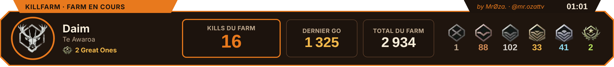

# KillFarm Lite 2.1

**Le compteur de farm de Great One pour theHunter: Call of the Wild (PC).**
Chaque bête ramassée est comptée toute seule, avec son grade, et le compteur repart de 0 quand ton Great One tombe.

**[⬇ Télécharger KillFarm Lite 2.1 (Windows, gratuit)](https://github.com/nicolashajker-cmd/killfarm-lite/releases/latest/download/KillFarm_Lite_v2.1.zip)** · [Site](https://nicolashajker-cmd.github.io/killfarm-lite/) · [Discord](https://discord.gg/vmB7kEreuW) · [TikTok @mr.ozattv](https://www.tiktok.com/@mr.ozattv) · [Appli Android](https://github.com/nicolashajker-cmd/killfarm-mobile/releases/latest/download/KillFarm.apk)

## Nouveau dans la 2.1
- 🏆 **Great One reconnu tout seul** : le compteur « depuis le dernier GO » repart de 0, « GREAT ONE ! » s'affiche.
- 📌 **Mini menu au bord de l'écran** : ton logo reste collé au bord, un clic et le mini menu sort (+1, annuler, Great One, changer de farm).
- 🔴 **Ta barre sur ton live** : un lien à coller dans TikTok LIVE Studio (source *Lien*) ou OBS (source *Navigateur*), en 1120 x 124.
- 🏁 **Tableau Stream compétitif** en bas au centre de l'écran, textes bien nets.
- 🎨 **Couleurs TikTok, Twitch et YouTube** (7 couleurs en tout), boutons arrondis, barre de titre sombre.
- 🖥 **2 écrans** : choisis celui du tableau et du mini menu.
- ⚙ **Menus rangés** : réglages en 4 parties, le même menu au clic droit partout.

## Installer
1. Télécharge `KillFarm_Lite_v2.1.zip` et dézippe-le.
2. Double-clic sur **KillFarm Lite.exe** : ta sauvegarde du jeu est trouvée toute seule.
3. Dans le jeu : Options › Affichage › **Fenêtré sans bordure**.

Mise à jour : remplace juste l'ancien `KillFarm Lite.exe`, tes farms sont gardés (`Documents\KillFarm_Lite`).
Windows bloque l'appli ? « Informations complémentaires » › « Exécuter quand même ». Détails dans `LISEZMOI.txt`.

## Ta barre sur ton live
1. Mini menu › **Lien du live** : l'adresse `http://127.0.0.1.nip.io:8777/` est copiée.
2. **TikTok LIVE Studio** : Ajouter une source › Lien › colle › Résolution personnalisée 1120 x 124.
   **OBS** : Sources › + › Navigateur › colle › 1120 x 124.
3. Fond transparent : ajoute `?fond=0` à la fin.

L'appli lit seulement ta sauvegarde et ne modifie jamais le jeu. La page de la barre ne marche que sur ton PC : rien n'est envoyé sur Internet.

---

### 🇬🇧 English
**KillFarm Lite** counts every animal you harvest on your Great One farm, with its grade, and resets the counter when your Great One drops. New in 2.1: mini menu on the screen edge, a live bar for TikTok LIVE Studio and OBS, TikTok / Twitch / YouTube colors. Fully in English. [Download (free)](https://github.com/nicolashajker-cmd/killfarm-lite/releases/latest/download/KillFarm_Lite_v2.1.zip) · instructions in `README.txt`.

*Projet de fan gratuit par MrØza., sans lien avec Expansive Worlds.*
